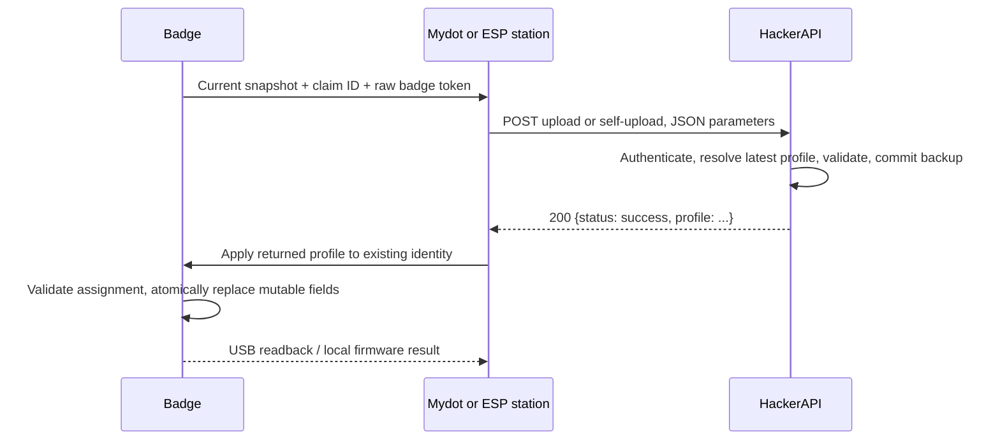

# Badge upload credentials and local integration

Registration generates 32 random bytes in Web Crypto, encodes them as 64 lowercase hex characters, and hashes the UTF-8 bytes of that exact string. Mydot stores `sha256:<digest>` on the 2026 application claim through HackerAPI `registerBadgeUploadToken`. Only the encoded raw token is written to the badge.

## USB protocol

After `put /littlefs/identity.json <length>` and `prov apply`:

1. Send `badge_token set` followed by bare CR.
2. Wait for `BADGE_TOKEN READY`.
3. Send exactly 64 raw ASCII hex bytes, with **no** newline. The command times out after 10 seconds. Bytes bypass the REPL and its command history.
4. Wait for `BADGE_TOKEN OK` and the next `badge> ` prompt.
5. Send `badge_token get` + CR and verify the `BADGE_TOKEN <64 hex>` reply. Do not log or display this reply.
6. Save the versioned hash through HackerAPI. Do not hand out a badge until both sides succeed. Retrying programming rotates both values.

The credential is a single committed NVS blob in `badge_upload/credential`, bound to the badge ID and claim ID. It survives reboot and `factory_reset` (which also preserves identity). Replacing either ID makes it unavailable until provisioned again; `prov erase confirm` clears it. NVS is separate from LittleFS, so neither `snapshot`, the snapshot viewer nor filesystem backups include it. Physical access can still extract credentials; this is not tamper-resistant storage.

USB sync clients use `prov show`, `snapshot`, and the explicit `badge_token get` command. Mydot's **Sync** sends the JSON and raw token to `/v3/badge-data/self-upload` using the signed-in user's JWT, without a claim ID. **Admin Sync** is organizer-only, previews the badge identity and snapshot, then sends to `/v3/badge-data/upload` after an explicit Save with the station password.

## Station transport v1

The BLE transfer payload is now the following envelope, protected by the existing transfer CRC and repair protocol:

```text
HTNSYNC1\n
<positive decimal claim ID>\n
<64 lowercase hex raw token>\n
<snapshot JSON object>
```

The diagram shows literal line separators as `\n`; the actual transport uses one LF after each of the first three lines. The station validates and removes those lines, builds the JSON request parameters documented below, and sends only `Content-Type: application/json`. The snapshot is nested under `badge_data`; credentials are sibling parameters. Only HTTP 200 confirms success. Missing credentials, malformed envelopes and legacy raw snapshots fail closed. Firmware and station updates must be deployed together.

The filesystem JSON remains capped at 20 KiB, plus at most 98 bytes of transport metadata, below the station's 52,785-byte transport ceiling and HackerAPI's 64 KiB limit. HackerAPI also rejects any snapshot containing the raw token (including a copy in file text).

## One-request sync

Both USB pages and the ESP station use one HTTP POST for a sync. They upload the
badge's **current** snapshot and receive the latest dashboard profile in that
same response. They then apply the profile to the badge. There is no preliminary
profile GET, second upload, or server callback acknowledging the device write.
The backup can contain the previous name/contact information; this is intentional.
A later sync captures the updated identity. Dashboard edits after the request
are picked up on the next sync.

After the returned profile is successfully written to the badge, all LEDs flash
green three times (250 ms on / 250 ms off). This runs on the UI timer without
blocking input, then restores the current app's lights. Failed profile writes
do not flash. USB Sync, Admin Sync and the ESP station share this behavior;
there is no additional HTTP request or LED command.

The display wakes and an open My Badge card immediately rebuilds its name,
contact details and QR from the updated identity, preserving the current view.
Other apps stay open; My Badge uses the new identity when opened. A contact/name
edit keeps the same badge ID, so the QR destination normally stays the same.
This feedback requires the updated attendee firmware, including for USB sync.



Use `Content-Type: application/json` and JSON body parameters. No custom HTTP
headers, Authorization header, URL parameters or version flag are needed.

Station/Admin Sync: `POST /v3/badge-data/upload`

```json
{
  "password": "<raw station password>",
  "claim_id": "123",
  "badge_secure_token": "<raw token read from this badge>",
  "badge_data": { "v": 1, "kind": "fs_mirror", "files": {} }
}
```

Hacker Sync: `POST /v3/badge-data/self-upload`

```json
{
  "user_token": "<user access JWT without a Bearer prefix>",
  "badge_secure_token": "<raw token read from this badge>",
  "badge_data": { "v": 1, "kind": "fs_mirror", "files": {} }
}
```

`badge_data` must be the actual snapshot object, not a quoted JSON string. Only
that object is persisted; credentials and the outer envelope are never saved.
`claim_id` accepts a positive integer or decimal string. The self route derives
the claim only from the verified user JWT; any supplied claim ID is ignored.
Organizer access gates the Admin Sync page, but uploading still requires its
password field. An organizer JWT cannot replace that password.

Every successful request returns the latest profile. Failures return the HTTP
status and `{ "error": "Readable explanation", "code": "stable_reason" }`.
Keep credentials in the body, never in URLs, logs, previews or committed files.
The parser caps the complete request at 69,632 bytes (68 KiB); the compacted
`badge_data` and its pipeline field remain limited to 65,536 bytes (64 KiB).
The extra 4 KiB is only envelope overhead. Increase the parser and snapshot/field
limits deliberately together if future firmware snapshots need more room.
Production/staging rate-limit these routes before parsing at 10,000 requests
per hour per hashed source IP, shared across both sync routes. Local development
and tests skip the limiter.

A successful response has `Cache-Control: no-store` and this shape
(example values are synthetic):

```json
{
  "status": "success",
  "profile": {
    "badge_id": "acorn-alpaca-anchor-apple",
    "claim_id": "123",
    "display_name": "Updated name",
    "net_email": "public@example.test",
    "net_phone": "",
    "net_linkedin": "handle",
    "net_discord": "",
    "net_instagram": "",
    "net_x": ""
  }
}
```

The profile always contains exactly those nine string keys. The IDs must match
what is already on the badge. Only the name and six networking fields change.
Account email, role, role colour, attendee ID, badge assignment, provisioning
time, app mode, games/files, and the NVS upload credential are preserved.
Empty strings clear removed contact fields; they do not retain old values.

HAPI resolves one assigned badge for the claim owner in `hackthenorth2026`.
Display name precedence is extended-profile `badge_display_name`, RSVP preferred
name, RSVP legal name, then the account name. Contacts come from the application
claim's `networking_*` fields. LinkedIn, Instagram and X URLs become their final
path segment; a leading `@` is removed. Printable Latin-1 text is accepted within
UTF-8 byte capacities: badge ID 63, claim ID 23, name 39, email 63, phone 19,
LinkedIn/Discord 39, Instagram/X 31. No truncation occurs. Missing or ambiguous
badge assignment returns 409; unsupported or overlong profile text returns 422.
These checks happen before the backup write. Error codes match safe audit
reasons such as `invalid_station_password`, `badge_token_mismatch`,
`badge_profile_unavailable`, `invalid_badge_profile`, and `payload_too_large`.

This replaces the earlier draft header contract; there is no legacy header
fallback. Deploy HAPI, Mydot and the station together. The badge-to-station BLE
protocol and profile apply command are unchanged. The HTTP contract alone does
not require reflashing the attendee badge; the immediate screen/LED feedback
described above does. The station must be rebuilt/flashed for the HTTP contract.
Clients require the returned profile before reporting a complete sync.

### USB completion and partial failures

`badge_profile apply <UTF-8-byte-count>` followed by CR starts a bounded command
(maximum 2,048 bytes). Wait for `BADGE_PROFILE READY`, write exactly that many
JSON bytes without a newline, then read `BADGE_PROFILE OK` and `badge> `.
The firmware validates the full key set and assignment, updates a temporary
identity file, and atomically renames it over the original only after validation
and a complete write. Errors keep the existing identity and token.
Mydot then reads the identity and token again, verifies every returned field and
checks the credential did not change before displaying success.

If the API denies/fails the request, neither the stored backup nor device profile
is updated. If the backup commits but the HTTP response is lost, the client may
not know that it saved; retry is safe for this snapshot-replacement operation.
If the response arrives but applying/verifying the profile fails or USB is
unplugged, the backup **remains saved**. Mydot explains this partial outcome and
asks the user to reconnect/retry. It does not roll back the backup or silently
send another request. A radio completion reports success only after the badge
applies the returned profile locally. CRC verifies transfer integrity, not origin.

### Last synced and preview

Hacker Sync shows only `badge_data_json.updated_at` from the owner's existing
GraphQL typed answer, as an absolute local time plus a relative age refreshed
every minute. It does not fetch the answer's `value` or show a snapshot preview.
An absent answer (epoch-zero wrapper) means Never; query errors mean Unavailable.
The timestamp is the server's latest backup-write time, **not confirmation of
profile application on the device**. It refreshes after the server confirms the
backup even if the subsequent profile update fails.

Admin Sync reads and previews the badge's current snapshot and destination
before any upload. Save uses the password field, commits that reviewed snapshot,
and applies the profile returned by the same POST. The existing preview is of
the backup being submitted; profile edits made on the dashboard are resolved by
HAPI at Save time. This page is organizer-only in routing and rendering.

### ESP station return transfer

The upstream `HTNSYNC1` credential envelope and snapshot format stay unchanged.
The badge sets `XFER_OPEN.want_downlink=1`; the station strips the envelope,
wraps the credentials and snapshot in JSON, and makes one POST to `SYNC_UPLOAD_URL`.
It buffers only the bounded response, extracts `profile` (maximum 2,048 bytes),
and returns it within the same BLE session/request ID.

`PROFILE_DATA` (0x16) frames contain a little-endian uint16 JSON byte length,
a little-endian uint32 CRC32 (seed 0), then JSON bytes, split at `BBX_MAX_BODY`.
The station holds each chunk in its advertising register until the matching
`PROFILE_ACK` (0x17) acknowledges its sequence. Badge MAC, session, request ID,
frame count, chunk lengths, bounds, ordering, duplicate bytes and CRC are checked.
Dropped advertisements/ACKs are retried through the repeated registers. After the
last ACK the station advertises `XFER_DONE`; the badge applies the complete
profile before showing Synced. Missing/corrupt profiles fail closed. Idle and
maximum leases release the station when a badge disappears. Legacy
`want_downlink=0` transfers still receive upload-only completion. The station's
`DONE` screen shows the endpoint's numeric code on refusal (`HTTP 401` wrong
station password, `403`/`404`/`409` registration, `422` overlong profile, `429`
rate limited); only the code is displayed, never bodies, tokens or profiles.

The BLE transport is unauthenticated and unencrypted, as in the existing badge
protocol. The token/snapshot and returned public networking profile are visible
in radio range. Do not interpret the MAC, CRC, shared station password or this
profile update as a higher-privilege identity proof.

## Build and test

Run `python3 tools/test-sync-upload.py` for host-side checks of the actual NVS credential functions, station HTTP forwarding, atomic profile application, UI revision notifications, and three-pulse LED feedback (with storage/network/LED stubs and the real IDF cJSON parser). Run `python3 tools/test-sync-radio.py` for both real transfer engines with packet loss, duplicate frames, corrupt CRC, incomplete responses, bounds and lease cleanup. Run `python3 tools/check-bbx-proto.py` to verify the shared BLE wire definitions.

```sh
source ~/.espressif/tools/activate_idf_v5.5.3.sh
python "$IDF_PATH/tools/idf.py" build
# Connect the badge when ready. Flash only the app/bootloader/partition table;
# do not erase NVS or flash a filesystem image over existing badge data.
python "$IDF_PATH/tools/idf.py" -p /dev/cu.usbmodemYOUR_PORT flash
```

If native USB will not reset, hold Start while plugging in USB, then retry. The normal app image is `build/hello_world.bin`; follow `build/flash_args` for offsets rather than guessing.

For the separate station, run `idf.py menuconfig` and `build` inside `tools/sync_station`. Set Wi-Fi, `SYNC_UPLOAD_URL`, and `SYNC_AUTH_TOKEN` (the raw station password supplied separately by the maintainer, kept outside source control). HackerAPI stores only the SHA-256 verifier in `badgeUploadPasswordHash`; the station must send the original encoded password, not that verifier. The raw password is 32 random bytes encoded as lowercase hex, and SHA-256 hashes the UTF-8 bytes of that exact string. Rotating the API verifier requires updating the raw password on stations too. A station or its compiled firmware still contains the raw credential, so do not reuse it for other services. The destination is station configuration, never badge-supplied. Leave synthetic boot self-tests disabled for HackerAPI; those old fixtures have no registered claim or credential. The station needs the Mac's LAN IP to reach a local API; a browser on the Mac uses `http://localhost`.

Host tests do not establish real RF delivery. Validate USB sync on a flashed badge, then BLE sync with a separate flashed station before event deployment.

## Mydot Connect and organizer maintenance

Mydot's `/badge/connect` decodes the owner's saved `fs_mirror` snapshot directly.
Contact files are `config/contacts/<badge-id>.cfg`, with `badge_id`, `name`,
`role`, `received_unix`, `email`, `phone`, `linkedin`, `discord`, `instagram`,
and `x` line values. Split each line on its first `=`. Re-bumping replaces that
badge's contact file. The dashboard sorts by name and shows a contact modal with
visible, validated links. `received_unix` comes from the badge's unsynchronized
clock; it must not be presented as an authoritative calendar date. Syncing via
USB or a station updates the saved list; no new networking ingestion API is used.

Organizer-only Admin Sync can also look up an eligible attendee by email and
set up a clean unit using the existing registration commands and GraphQL API.
It previews the current profile and rechecks eligibility, profile, assignment,
MAC and clean status before writing. Clean means unprovisioned plus a complete
filesystem scan containing only `config/system.cfg` and/or `solana.json`.
Other files, including malformed identity or old contacts, require an explicit
reset. The device wallet is preserved; this is not a wallet erase. Setup writes
identity plus a fresh NVS token and saves the versioned verifier and badge MAC
on the application claim as `badge_secure_token_hash` and `badge_mac` field answers. It does not restore contacts/files, change check-in status,
or overwrite the server's backup. Replacing an existing badge's credential
invalidates that badge's previous upload token.

The new controls reuse commands already supported by this firmware:

- **Factory reset badge** confirms the selected unit, sends `prov erase confirm`
  to clear its identity and credential, then `factory_reset confirm` to remove
  config/contacts, Lua apps and app data and reboot. Both acknowledgements must
  succeed. Unsynced data is lost; the Solana key and server backup stay intact.
  The standalone firmware `factory_reset` command continues to preserve identity
  and wallet. Mydot deliberately invokes the separate provisioning erase first.
- **Unlock all public apps** sends `seedall`, adding only the Public access tier.
  It never calls `appmode all` or grants Internal diagnostic access. Existing
  unlocks, role, identity and data are preserved.

The station password field remains mandatory for snapshot upload. Organizer
GraphQL authorization is used separately for email lookup and registration;
it is never substituted for the upload password. Normal USB/ESP sync still uses
one POST, returning the current profile after saving the uploaded snapshot.
